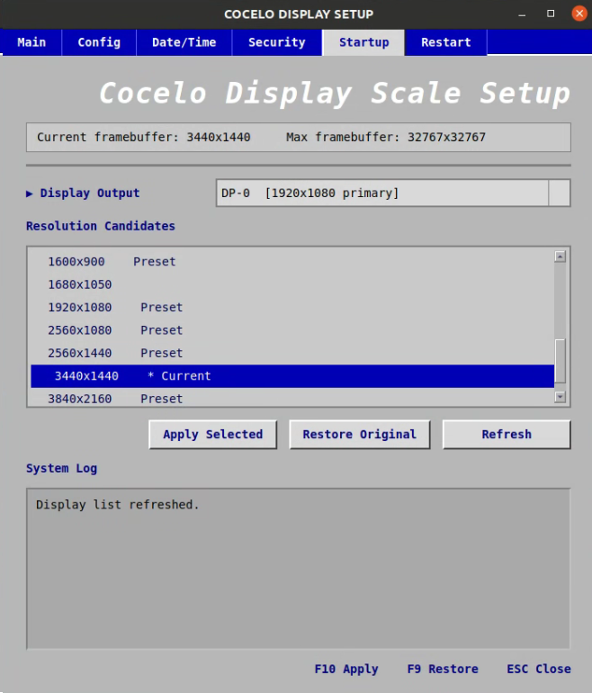

# Cocelo Display Scale

RustDesk 원격 접속 환경에서 화면 해상도와 논리적 framebuffer 크기를 간편하게 변경하기 위한 PyQt5 기반 GUI 도구입니다.



## 주요 기능

* 현재 연결된 디스플레이 출력 자동 감지
* `xrandr` 기반 해상도 및 framebuffer 변경
* RustDesk 원격 화면 크기 확장
* BIOS 스타일의 간단한 사용자 인터페이스
* 최대 framebuffer 크기에 맞춰 프리셋 필터링
* 지정된 해상도 프리셋 제공
* 100·125·150·175·200·250·300% 논리 화면 배율 프리셋
* 앱 창과 바탕화면 실행 아이콘 제공
* 디스플레이 기본 해상도 복원
* 키보드 단축키 지원
* 실행 명령 및 오류 로그 표시

## 지원 해상도

다음 해상도가 기본 프리셋으로 제공됩니다.

* 1280×720
* 1280×800
* 1366×768
* 1440×900
* 1600×900
* 1680×1050
* 1920×1080
* 1920×1200
* 2560×1080
* 2560×1440
* 2560×1600
* 2880×1800
* 3440×1440
* 3677×1440
* 3840×2160
* 3840×2400

`Resolution Candidates`에는 기본 해상도 프리셋만 표시합니다. 배율로 계산된 해상도와 디스플레이의 추가 모드는 목록에 넣지 않으며, 퍼센트는 `Logical Scale`에서만 표시합니다.

단, 구형 RandR의 `default` 출력에서는 Xorg가 실제 제공하는 해상도 모드만 표시하고 `Logical Scale`을 비활성화합니다. 이 출력은 `xrandr --size`로 화면 모드를 직접 변경하며, Restore도 같은 방식으로 기본 모드를 적용합니다. 원하는 해상도가 없다면 Xorg 설정에 모드를 등록하고 Xorg 재시작 후 `Refresh`로 다시 조회해야 합니다.

`Logical Scale`에서 100·125·150·175·200·250·300%를 선택하면 현재 선택한 출력 모드를 기준으로 가로·세로 크기를 계산합니다. 예를 들어 `1920×1200` 출력에서 150%는 `2880×1800`입니다. 소수 픽셀은 반올림하며, 최대 framebuffer 크기를 초과하는 해상도와 배율은 목록에서 제외합니다.

이 배율은 논리 화면 크기의 비율입니다. OS의 글자/UI 확대 배율과 달리, 값이 커질수록 더 넓은 작업 공간을 실제 모니터 크기에 맞춰 표시합니다. 배율 선택 후 `Apply Selected`를 눌러 적용합니다.

해상도 프리셋과 배율 중 마지막으로 선택한 값을 적용합니다. 해상도 목록에서 항목을 선택하면 `Logical Scale`은 `Use resolution preset`으로 돌아갑니다.

## 동작 방식

이 프로그램은 실제 모니터의 출력 모드는 유지하면서 `xrandr --scale-from` 옵션을 사용해 논리적인 화면 크기를 변경합니다.

예를 들어 실제 디스플레이 모드가 `1920x1080`인 상태에서 `3440x1440`을 적용하면 다음과 유사한 명령이 실행됩니다.

```bash
xrandr \
  --fb 3440x1440 \
  --output HD-0 \
  --mode 1920x1080 \
  --scale-from 3440x1440 \
  --pos 0x0
```

이를 통해 RustDesk에서 더 넓은 해상도의 원격 화면을 사용할 수 있습니다.

## 복원 기능

`Restore Original` 버튼을 누르면 저장된 이전 framebuffer 값이 아니라, 현재 연결된 `HD-0` 디스플레이의 기본 해상도로 복원합니다.

복원 시 출력 선택 순서는 다음과 같습니다.

1. `HD-0`
2. `HDMI-0`
3. Primary 출력
4. 첫 번째로 감지된 연결 출력

기본 해상도는 `xrandr`에서 preferred mode로 표시된 해상도를 우선 사용합니다.

복원 시 다음 설정이 함께 초기화됩니다.

* Display scale: `1x1`
* Panning: 비활성화
* Position: `0x0`
* Framebuffer: 디스플레이 기본 해상도

## 요구 사항

### 운영체제

* Ubuntu 또는 `xrandr`를 지원하는 Linux 데스크톱 환경
* X11 세션

Wayland 세션에서는 `xrandr`가 정상적으로 동작하지 않을 수 있습니다.

현재 세션 종류는 다음 명령으로 확인할 수 있습니다.

```bash
echo $XDG_SESSION_TYPE
```

출력값이 `x11`이어야 합니다.

### Python

* Python 3.8 이상 권장
* PyQt5

### 시스템 패키지

```bash
sudo apt update
sudo apt install -y x11-xserver-utils python3-pyqt5
```

Conda 환경을 사용하는 경우 다음과 같이 설치할 수 있습니다.

```bash
conda install -n base pyqt
```

또는 pip를 사용할 수 있습니다.

```bash
python3 -m pip install PyQt5
```

## 실행 방법

저장소를 내려받습니다.

```bash
git clone <repository-url>
cd remote-display-scale
```

실행 권한을 부여합니다.

```bash
chmod +x display_scale_app.py
```

프로그램을 실행합니다.

```bash
python3 display_scale_app.py
```

Conda의 `base` 환경에서 실행하려면 다음 명령을 사용할 수 있습니다.

```bash
conda run -n base python display_scale_app.py
```

바탕화면 실행 아이콘을 설치하거나 기존 설치를 업데이트하려면 다음을 실행합니다.

```bash
./install.sh
```

앱과 아이콘을 `~/.local/share/cocelo-display-scale/`에 복사하고 바탕화면 실행 파일을 생성합니다.

## 사용 방법

1. 프로그램을 실행합니다.
2. `Display Output`에서 적용할 디스플레이를 선택합니다.
3. `Resolution Candidates`에서 원하는 해상도를 선택하거나 `Logical Scale`에서 배율을 선택합니다.
4. `Apply Selected` 버튼을 누릅니다.
5. RustDesk에서 변경된 화면이 반영되지 않으면 원격 연결을 다시 접속합니다.
6. 기본 디스플레이 해상도로 돌아가려면 `Restore Original` 버튼을 누릅니다.

해상도 항목을 더블 클릭해도 바로 적용할 수 있습니다.

## 단축키

| 단축키 | 기능               |
| ------ | ------------------ |
| `F10`  | 선택한 해상도 적용 |
| `F9`   | 기본 해상도로 복원 |
| `ESC`  | 프로그램 종료      |

## 버튼 설명

### Apply Selected

선택한 논리 해상도를 현재 디스플레이에 적용합니다.

실제 모니터 출력 모드는 유지되며 framebuffer와 scale 값만 변경됩니다.

### Restore Original

`HD-0` 또는 대체 출력의 preferred/native 해상도로 복원합니다.

이전 실행 시 저장된 framebuffer 값은 사용하지 않습니다.

### Refresh

현재 연결된 디스플레이, 출력 모드, framebuffer 크기 및 지원 해상도를 다시 조회합니다.

## 상태 파일

프로그램은 다음 경로에 상태 파일을 생성할 수 있습니다.

```text
~/.config/cocelo-display-scale/original_state.json
```

현재 Restore 기능은 이 파일에 저장된 이전 framebuffer를 사용하지 않고, `xrandr`에서 조회한 디스플레이 기본 해상도를 기준으로 복원합니다.

## 출력 이름 확인

시스템에서 사용하는 디스플레이 출력 이름은 다음 명령으로 확인할 수 있습니다.

```bash
xrandr --query
```

출력 예시는 다음과 같습니다.

```text
HD-0 connected primary 1920x1080+0+0
HDMI-0 disconnected
DP-0 disconnected
```

환경에 따라 출력 이름은 다음처럼 다를 수 있습니다.

```text
HD-0
HDMI-0
DP-0
DP-1
eDP-1
Virtual-1
```

## 문제 해결

### `RRSetCrtcTransform` / `BadValue` 오류

`default` 출력의 구형 dummy 드라이버는 `--scale-from` 변환을 지원하지 않을 수 있습니다. 최신 앱은 이 출력에서 변환 대신 등록된 해상도로 직접 전환합니다. 기존 설치를 사용 중이면 `./install.sh`로 업데이트하고 앱을 닫았다가 다시 실행하세요. `Failed to get size of gamma` 경고와 별개로, `RRSetCrtcTransform` 오류는 화면 변환 요청이 거부됐다는 뜻입니다.

### `xrandr: command not found`

다음 패키지를 설치합니다.

```bash
sudo apt install x11-xserver-utils
```

### `ModuleNotFoundError: No module named 'PyQt5'`

PyQt5를 설치합니다.

```bash
python3 -m pip install PyQt5
```

Conda 환경에서는 다음 명령을 사용합니다.

```bash
conda install -n base pyqt
```

### 해상도를 적용했지만 RustDesk 화면이 바뀌지 않음

RustDesk가 기존 framebuffer 크기를 유지하고 있을 수 있습니다.

다음 순서로 다시 시도합니다.

1. 해상도를 적용합니다.
2. RustDesk 연결을 종료합니다.
3. RustDesk에 다시 연결합니다.

### Restore 실행 후 화면이 정상적으로 돌아오지 않음

현재 출력 상태를 확인합니다.

```bash
xrandr --query
```

`HD-0`이 존재하지 않는 시스템에서는 프로그램이 `HDMI-0`, primary 출력 또는 첫 번째 연결 출력을 사용합니다.

수동으로 복원하려면 다음과 같이 실행할 수 있습니다.

```bash
xrandr \
  --output HD-0 \
  --auto \
  --scale 1x1 \
  --panning 0x0 \
  --pos 0x0
```

출력 이름이 다른 경우 `HD-0`을 실제 출력 이름으로 변경해야 합니다.

### Wayland에서 실행되지 않음

로그인 화면에서 세션을 종료한 후 Ubuntu 또는 GNOME의 Xorg 세션으로 로그인합니다.

예시:

```text
Ubuntu on Xorg
```

## 주의사항

* 프로그램은 X11 환경에서 동작합니다.
* 디스플레이가 지원하지 않는 framebuffer 크기를 적용하면 화면이 비정상적으로 표시될 수 있습니다.
* 너무 큰 해상도를 적용하면 원격 접속 성능이 저하될 수 있습니다.
* 복원 기능은 `HD-0`을 우선 대상으로 사용합니다.
* RustDesk 환경에 따라 해상도 변경 후 재접속이 필요할 수 있습니다.

## 프로젝트 구조

```text
remote-display-scale/
├── display_scale_app.py
├── install.sh
├── readme.md
├── assets/
│   ├── cocelo-display-scale.png
│   └── icon-prompt.txt
└── figures/
    └── image.png
```

## License

This project is intended for internal use by Cocelo Inc.
